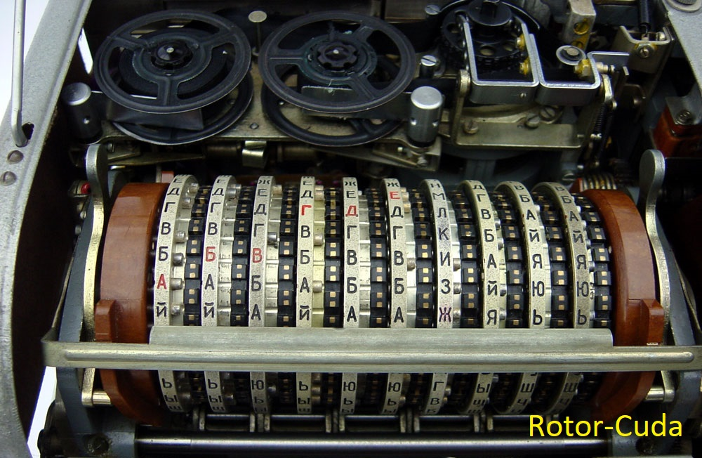

# Rotor-Cuda v2.0-rotor (mytab0r fork)



Maintained by **mytab0r** — https://github.com/mytab0r/Rotor-Cuda

This is a modified version of KeyHunt v1.7 ...
A secp256k1 key-search tool for authorized public puzzle events. This fork reuses code from KeyHunt, VanitySearch / JeanLucPons, and Mehdi256's Rotor-Cuda v2. Licensed under GPLv3.0; original copyrights are retained. It is not for mass scanning or de-anonymization.

## What this fork adds (mytab0r) :
- **BSGS mode `--mode bsgs`** — recover a scalar from a known **public key** inside a `--range START:END` (baby-step/giant-step over secp256k1, CPU). Baby table + binary-fuse fast-reject + EC re-verify. For authorized public puzzles where the pubkey is exposed.
- **GPU BSGS backend `--mode bsgs -g`** — explicit one-GPU giant walk with
  shared baby table, canonical-X folding, exhaustive `dpBits=0` output, and
  final EC re-verification. No silent CPU fallback; multi-GPU scheduling is
  deferred.
- **GPU address/xpoint search `-g`** — the CUDA kernels from `GPU/` run behind
  `--features gpu` for `-m address|addresses|xpoint|xpoints` (BTC and ETH):
  range split into one chunk per GPU thread, bloom/target prefilter on device,
  exact target lookup and EC re-verification on the host. `--gpui 0,1,...` scans
  disjoint slices on several devices with shared output; `-r` rotates random
  start keys and `-n` persists/resumes runs through the same
  `Rotor-Cuda_Continue.bat`/`START.bat` files as the CPU engine.
- **GPU BSGS batch inversion** — W independent walks share Montgomery inversion;
  verified on RTX 5070 (`sm_120`) against GMP ground truth. See
  `bsgs/BATCH_INVERT.md`.
- **GPU BSGS distinguished-point filter** — canonical-X DP emission with honest
  `total` and fail-loud `truncated` reporting. See `bsgs/DP_FILTER.md`.
- **GPU Pollard kangaroo baseline** — internal and not CLI-exposed. SOTA K≈1.15,
  persistent walks, and multi-GPU remain follow-up work. See `bsgs/KANGAROO.md`.
- **Filter catalog** — binary-fuse filter alongside the classic bloom for large hash160 sets (lower false-positive at similar memory).
- **Distributed coordinator `rotor-coord`** — token-protected HTTP/JSON server plus an embedded dashboard; several clients (CPU or GPU, one or more devices per client) lease disjoint key chunks of one job, BSGS giant-walk progress is stored remotely and resumed, and found keys are re-verified with `k*G == target` before they are accepted.
- **Self-update** — SHA-256 verified binary self-replace via WinHTTP + MoveFileEx rename-trick (Windows).
- **Cloud CI/CD** — GitHub Actions run the Rust build/test matrix (CPU + wasm), compile the CUDA `gpu` feature (`gpu-bsgs-compile.yml`) and publish `rust-release.yml` assets; no local toolchain needed. The legacy C++ MSBuild workflows were removed with the application.
- Only for **authorized public puzzle events** (known addresses, known bit ranges, official rewards). Not for mass scanning or de-anonymization.

### Chain selection (`--chain`, `--list-chains`)
`--chain <slug>` selects one of the 18 site networks (slug or ticker alias such
as `btc`, `eth`, `sol`, `doge`). `--list-chains` prints every chain with its
family, curve and the search modes implemented in this build:

```sh
./target/release/rotor --list-chains
./target/release/rotor -m address --chain bitcoin --range 1:2 1BgGZ9tcN4rm9KBzDn7KprQz87SZ26SAMH
./target/release/rotor -m addresses --chain ethereum --range 1:2 --targets-text eth.txt
```

Descriptor and address derivation cover all 18 chains, but the search engines
currently implement `bitcoin` (secp-hash160: `address`, `addresses`, `xpoint`,
`xpoints`, `bsgs`) and `ethereum` (evm-keccak: `address`, `addresses`, `bsgs`).
Selecting any other chain/mode pair fails with a non-zero exit and names the
chain plus its supported modes; there is no silent fallback. The old
`--coin BTC|ETH` spelling still works as a deprecated alias for
`--chain bitcoin|ethereum` and prints a warning.

### BSGS usage (CPU) :
```
./Rotor --mode bsgs --range 400000000000000000:7fffffffffffffffff 02CEB6CBBCDBDF5EF7150682150F4CE2C6F4807B349827DCDBDD1F2EFA885A2630
```

### BSGS work files (offline resume)
CPU-BSGS can persist the baby table and the giant-walk position in a binary work
file, so a restarted run resumes without rebuilding the table (no baby-step EC):

```sh
./target/release/rotor -m bsgs --range 400000000000000000:7fffffffffffffffff \
  --bsgs-work bsgs-job.rwork \
  02CEB6CBBCDBDF5EF7150682150F4CE2C6F4807B349827DCDBDD1F2EFA885A2630
```

`--bsgs-work FILE` writes the file at startup and then at most once every 30 s
when the giant index advanced, plus once when the walk stops (found, exhausted
or Ctrl-C). Saves are atomic (`FILE.tmp` + rename); a failed save is reported and
exits non-zero instead of looking successful.

On restart the file is loaded and validated against the run: format version,
curve, `--range`, target public key, baby size and the table checksum. Any
mismatch (or a corrupted/truncated file) fails loudly, names the differing
field and exits non-zero; a foreign table is never silently reused. Pass
`--bsgs-work-reset` to overwrite a mismatched or stale file and start again from
giant index 0. The file format is version 1 (`RBWF` magic, little-endian header,
ordered folds and a SHA-256 trailer). Work files are CPU-BSGS only; in
coordinator mode the remote state decides the resume index, while a requested
local work file is still written.

### BSGS usage (GPU) :
```
./Rotor --mode bsgs -g --gpui 0 --range 400000000000000000:7fffffffffffffffff 02CEB6CBBCDBDF5EF7150682150F4CE2C6F4807B349827DCDBDD1F2EFA885A2630
```
Building with the GPU backend needs the CUDA Toolkit (nvcc): `cargo build --release
--features gpu` (on Windows use the MSVC Rust toolchain). The build links the CUDA
runtime statically (`cudart_static`), so the resulting binary runs on a machine with
only the NVIDIA driver — no CUDA Toolkit and no `cudart` DLL on PATH.
`ROTOR_CUDA_ARCHS` selects the target architectures (default `75` = sm_75 cubin plus
PTX so newer GPUs JIT; use `120` for RTX 50xx). Release builds ship cubins for
`52,75,80,86,89,90,100,120`; building sm_120 needs CUDA 12.8+.
`-g` selects GPU-BSGS with `--gpui` and GPU address/xpoint search with `--gpui`/`--gpux`.
The GPU search path fails loudly on invalid devices, unsupported options, or
output truncation; it never falls back to CPU. On an NVIDIA host,
`cargo test --features gpu` runs the CPU==GPU fixtures for BSGS and for
address/xpoint search (they print a skip line when no device is present).

### GPU address/xpoint search on multiple devices

List every device after `--gpui`; `--gpux` takes two grid values per id (omit it
to use the default `8 * SM count, 128` per device):

```sh
./target/release/rotor -g --gpui 0,1 --gpux 2,128,2,128 \
  -m address --chain bitcoin --range 400000000000000000:7fffffffffffffffff \
  1PWo3JeB9jrGwfHDNpdGK54CRas7fsVzXU
```

The inclusive range is partitioned into one contiguous, disjoint chunk per id
(ceil chunk size, the last clipped at `--range END`) and each device scans its
own chunk. What is shared:

- one Ctrl-C stop flag, so stopping the process ends every device at its next
  kernel batch;
- the found counter: a single-target hit (or the whole requested set in
  `addresses`/`xpoints`) stops the other devices at their next batch;
- one output sink behind a mutex, so `Found.txt` blocks and progress lines never
  interleave. Multi-device progress lines name the device (`GPU #0`, `GPU #1`).

With `--coordinator`, every device runs its own lease loop and client id
(`<client-id>-gpu<index>`), so the server keeps chunks disjoint. A found key
ends that device's loop; the other devices see the job as done and stop with
204. Duplicate or negative `--gpui` ids are rejected before any engine starts;
an id outside the visible device count keeps the launcher's invalid-device
error. The single-id path is unchanged.

Real multi-GPU execution is not yet verified on hardware: this repository's
device evidence is single-GPU (one RTX 5070), so the host orchestration is
covered by unit tests and the multi-device run is pending a multi-GPU host.

### GPU random mode and checkpoints (`-r`, `-n`)

`-r N` draws a fresh random start key on every device once the *global* scanned
counter crosses another `N * 1_000_000_000` keys. The start is uniform in
`--range`, or below `2^-n` bits, or inside the `-n..-z` band when `-r > 0`
(in that mode `-n` is the bit width, not a checkpoint period). Each device scans
upward from its start in short windows until the target set is found, Ctrl-C,
or the process is stopped. Progress switches to the CPU random form with the GPU
rate:

```
[time] [R: rotations] [KEY] [F: found] [GPU #0: rate] [T: scanned]
```

`-n M` *without* `-r` enables checkpoints: before scanning, the run reads
`Rotor-Cuda_Continue.bat` and shifts every device range by its saved count (the
`threads:`/`chunks:` extension; a mismatched device count falls back to
`count / devices`). Without a usable file it writes `Rotor-Cuda_START.bat`. The
checkpoint is rewritten every `M * 55` seconds and once on exit, with the total
and the per-device cumulative counts.

Random runs are not resumable, so `-r` and `-n` checkpoints are mutually
exclusive; both stay rejected with `--coordinator` because progress lives on the
server. Random and checkpoint *device execution* is host-tested and pending a
working CUDA host (no local toolkit); CI compiles the `gpu` feature.

## Distributed coordinator (`rotor-coord`)

A second binary in the same crate lets several machines work one range without manual
splitting: `rotor-coord` leases disjoint key chunks, keeps progress in one JSON file, and
serves a public site plus a dashboard. Clients may be CPU workers or a GPU
`--features gpu` build.

### Quick start

Build both binaries (`target/release/rotor[.exe]` and `rotor-coord[.exe]`), then start
the coordinator (admin token from `--token` or `ROTOR_COORD_TOKEN`; optional per-client
token map from `--clients`, see Security below):

```sh
cargo build --release --bins
./target/release/rotor-coord --token my-secret --state coordinator.json      # Linux
target\release\rotor-coord.exe --token my-secret --state coordinator.json   # Windows
```

It listens on `http://127.0.0.1:7878` (`--bind ADDR` overrides) and serves a public
site: the landing page with live totals at `/`, the operator dashboard at `/app`, a
personal cabinet at `/me` and the docs at `/docs`. Client accounts can be created by the
admin (`POST /api/v1/clients`), imported once from a `--clients` file, or self-registered
with `--open-registration`. Create one job in the dashboard (paste the admin token first),
or with curl:

```sh
curl -s -H "Authorization: Bearer my-secret" -H "Content-Type: application/json" -d '{"mode":"address","coin":"btc","comp_mode":"compressed","target":"1PWo3JeB9jrGwfHDNpdGK54CRas7fsVzXU","start":"400000000000000000","end":"7fffffffffffffffff"}' http://127.0.0.1:7878/api/v1/jobs
```

Run two clients (the second with `--client-id machine-b`) on the same target and range:

```sh
./target/release/rotor -m address --chain bitcoin --range 400000000000000000:7fffffffffffffffff \
  --coordinator http://127.0.0.1:7878 --token my-secret --client-id machine-a \
  1PWo3JeB9jrGwfHDNpdGK54CRas7fsVzXU
```

Each client leases the next free chunk (width `0x10000000`, TTL 600 s), heartbeats every
5 s and re-leases on completion, so slices never overlap. Chunks are handed out in a
scattered but complete order: a per-job full-cycle permutation
`(seed + cursor × step) mod chunks_total` with `gcd(step, chunks_total) = 1`, and the
cursor is persisted so the scatter continues after a restart. An unrefreshed lease returns
to the pool; once all chunks are done leases answer 204 and clients stop. `Found.txt` is
written locally; the found key is also POSTed, and the coordinator verifies `k*G` against
the job target before accepting and marking the job found on the dashboard.

The state file is compact: completed chunks are a packed bitmap serialized as lowercase
hex (`ceil(chunks_total / 8)` bytes, bit `i % 8` of byte `i / 8`) and `scanned` is
aggregated per job, so a 1,000,000-chunk job needs about 250 KiB instead of one record
per chunk. Client accounts, their stats and a bounded history (240 points) live in the
same file; the token is stored only as a SHA-256 hash. The file carries `"version": 2`;
a state file with a missing or older version is rejected with a clear message and must be
moved or deleted to start fresh (there is no silent migration). A version-2 file written
before accounts existed still loads with an empty client list.

### GPU clients

A `--features gpu` build uses the same lease/heartbeat protocol as the CPU client, but
it scans one leased window at a time synchronously on the device: heartbeats are sent
between chunks and at the end of each chunk, never during a scan. The engine and its
generator table are created once and reused across leases; each lease only rebuilds the
key plan, uploads its starting points and scans the window. If a heartbeat is lost
because another client already submitted the found key (the job is found/done), the GPU
client stops normally; a lost lease on a still-active job aborts. Build with the CUDA
Toolkit as described above, then add `-g` to the same command (`--gpui` selects one or
more devices; with several ids each device gets an independent lease loop and client id
`<client-id>-gpu<index>`):

```sh
./target/release/rotor -g --gpui 0 -m address --chain bitcoin --range 400000000000000000:7fffffffffffffffff \
  --coordinator http://127.0.0.1:7878 --token my-secret --client-id rig-a \
  1PWo3JeB9jrGwfHDNpdGK54CRas7fsVzXU
```

Supported modes are `address|addresses|xpoint|xpoints` for BTC and `address|addresses` for
ETH, with the same proof submission and `Found.txt` output as the CPU path. `-r`, `-n`
and `--gpux` follow the normal GPU limits. `-m bsgs -g` is rejected with `--coordinator`:
coordinator BSGS runs on the CPU (drop `-g`). Multiple `--gpui` ids run one lease loop per
device in a coordinator client; coordinator BSGS remains one device.
Because a chunk is scanned synchronously, a chunk wider than `lease_ttl × device rate`
cannot be refreshed mid-scan; its lease may expire and the chunk may be handed to
another client (and scanned twice).

### Browser client (WebAssembly)

`rotor-coord` also serves a browser client at `/run`: open
`https://<coordinator>/run` (or `http://localhost:<port>/run` locally), paste a
client token from the cabinet, and press Start. The tab runs the WASM scan core
on the CPU, leases the same chunks and submits the same completion proofs as the
native client.

- Measured on the development machine: **~300–400k keys/s per tab**. The page
  shows its own measured rate; treat that number as the real one.
- Jobs for browsers should use `chunk_width` 2^20–2^22 and `lease_ttl` 120–300
  seconds, so one tab can finish and heartbeat a chunk inside its lease.
- The page requires HTTPS or localhost (browsers restrict the APIs it needs on
  plain-HTTP remote origins).
- The token is stored in this browser's `localStorage` and sent only in the
  `Authorization` header.
- It only leases jobs the operator already created (authorized puzzle jobs
  only); a client token cannot create jobs.

`scripts/build-wasm.sh` builds `crates/rotor-wasm` for
`wasm32-unknown-unknown` and copies the result to `apps/site/rotor_wasm.wasm`. That
artifact is committed and rebuilt by CI and the Docker image; the coordinator
embeds it and serves `/run`, `/rotor-worker.js` and `/rotor_wasm.wasm`.
Requires `rustup target add wasm32-unknown-unknown` once.

Web UI changes go through [`apps/site/UI-CHECKLIST.md`](apps/site/UI-CHECKLIST.md): states,
375/768/1280 layouts, focus/keyboard, reduced motion and the browser checks.

### Private-key explorer

`/key` is a read-only private-key explorer. Open `https://<coordinator>/key`
(or `http://localhost:<port>/key` locally). Derivation runs in the browser in
the same WASM artifact the worker uses; the coordinator only serves the page.

- Accepts a key as hex (64 chars, optional `0x`), a decimal integer, or a
  Bitcoin WIF.
- Curves: secp256k1 and ed25519.
- Addresses: BTC legacy/P2SH/segwit/taproot, EVM, TRON, Solana, Litecoin,
  Dogecoin, Bitcoin Cash and XRP. Every
  calculation is expandable to show the intermediate values.
- Online balance lookups are opt-in and off by default. When enabled, only the
  derived addresses currently shown are queried: BTC via mempool.space, EVM via
  a short ordered fallback list of public Ethereum JSON-RPC endpoints
  (ethereum-rpc.publicnode.com, eth.drpc.org, 1rpc.io), TRON via Tronscan.
  Nothing else is sent.
- The private key never leaves the browser and is not stored in the URL,
  history or local storage.
- This is not a wallet: it offers no signing or sweeping. A key that holds
  funds should be handled offline on an air-gapped machine, never typed into an
  online page.


### Public key pages and the cabinet

`/keys` and `/keys/<chain>` are indexable hubs with breadcrumbs, JSON-LD and
links to deterministic example keys. `/key/<64hex>` renders the derivation page
for that key with per-key metadata; the page is `noindex,follow` (thin-content
and safety policy), while the hubs are indexed and listed in `/sitemap.xml`.
The key is in the URL, so the coordinator already knows the requested key; the
page also shows a notice and sends only the derived addresses to the registry
check so a registered owner can be warned. Type a key locally on `/key`
without a URL and no check happens unless you tick the opt-in box.

The personal area moved to `/cabinet`, reachable only after wallet
authentication; `/monitor` redirects there. `/me` remains the legacy
contributor-token cabinet but is no longer in the navigation.

### Address monitor

`/monitor` is a watch-only service for addresses you control. Connect an
injected EVM wallet, sign the one-time SIWE challenge, and the coordinator
stores the wallet's EVM accounts as watches. The watcher polls each address
(`eth_getBalance` / `eth_getTransactionCount` by default) and adds an event to
your cabinet feed when the balance or nonce changes. It never asks for a
private key, WIF or seed phrase, and never signs for you.

- The address that signed the login is `verified`; other imported accounts are
  stored as `unverified`. BTC addresses can be added manually (checksum is
  validated) but remain unverified until a chain-specific signature flow ships.
- `/key` has an unchecked "Check these addresses against the Rotor registry"
  box. When enabled, it sends the derived addresses (never the key) to
  `POST /api/v1/monitor/exposure`; the coordinator returns only a match count
  and records a "lookup" event for the owner. With the box off, no request is
  made.
- `recovery_opt_in` in the cabinet is consent to be contacted about recovery
  help; it is not an instruction to move funds, and the service never takes
  custody or sweeps balances.
- Operator flags: `--monitor-state /data/monitor.json`,
  `--monitor-domain <public host>` (fixed SIWE domain), `--monitor-interval`
  (seconds, default 300), `--monitor-rpc <EVM JSON-RPC>`, and `--trust-proxy`
  when running behind the reverse proxy so rate limits use the real client IP.

### BSGS resume

A `bsgs` job is searched as one giant walk, not chunk by chunk. Create it with the
public key (66 or 130 hex chars) as target:

```sh
curl -s -H "Authorization: Bearer my-secret" -H "Content-Type: application/json" -d '{"mode":"bsgs","start":"400000000000000000","end":"7fffffffffffffffff","target":"02CEB6CBBCDBDF5EF7150682150F4CE2C6F4807B349827DCDBDD1F2EFA885A2630"}' http://127.0.0.1:7878/api/v1/jobs
```

Then run the client with the same public key and range:

```sh
./target/release/rotor -m bsgs --coordinator http://127.0.0.1:7878 --token my-secret \
  --range 400000000000000000:7fffffffffffffffff \
  02CEB6CBBCDBDF5EF7150682150F4CE2C6F4807B349827DCDBDD1F2EFA885A2630
```

The client rebuilds the baby table deterministically, fetches `{manifest, giant_index}`, and continues the giant walk from that index when `TableManifest::compatible` accepts it. Progress is posted every 5 s and once on exit, so a restarted client resumes where it stopped; a different table identity is rejected with `409 manifest mismatch`.

### API

`/api/v1/*` requires `Authorization: Bearer <token>` (401 otherwise), except the static
site and the public `GET /api/v1/summary` (aggregate totals and top-10 leaderboard) and
`POST /api/v1/register` (when `--open-registration` is set). The pages poll every 2 s:
the landing uses `/api/v1/summary`, the dashboard `/api/v1/status`, the cabinet `/api/v1/me`.

| Route | Method | Purpose |
|---|---|---|
| `/`, `/app`, `/me`, `/docs` | GET | landing, dashboard, cabinet and docs HTML |
| `/site.css`, `/site.js` | GET | shared static assets |
| `/api/v1/summary` | GET | public totals + leaderboard + `registration_open` |
| `/api/v1/register` | POST | self-service `{name}` -> `{id, token}` when enabled; 403 otherwise |
| `/api/v1/clients` | GET / POST | list accounts / create one (admin); returns the token once |
| `/api/v1/clients/{id}/disable` | POST | disable an account and release its leases (admin) |
| `/api/v1/me` | GET | own record, rank, active lease, job progress, recent results (client) |
| `/api/v1/jobs` | GET / POST | list jobs / create a job (201, admin token) |
| `/api/v1/lease` | POST | lease the next free chunk (200; 204 when exhausted); returns `lease_id` + `challenge_offsets` |
| `/api/v1/heartbeat` | POST | refresh a lease or finish it (echo `lease_id`, `done` needs `samples`); 409 when the lease was lost |
| `/api/v1/result` | POST | submit a found key (echo `lease_id`); the proof is checked first |
| `/api/v1/status` | GET | jobs, active clients, results, BSGS checkpoints, totals, leaderboard |
| `/api/v1/bsgs/state` | GET / POST | read (`?job_id=...`) / store `{manifest, giant_index}` |

### Security

- The admin token is mandatory (`--token` or `ROTOR_COORD_TOKEN`). It creates and
  lists jobs and reads the dashboard; it cannot lease, heartbeat or submit
  results.
- Client accounts live in the state. `--clients FILE` is a JSON map
  `{ "client-id": "<sha256 hex of the token>" }` imported on the first start;
  afterwards the state is authoritative. Accounts can also be created with the
  admin API or, with `--open-registration`, through `POST /api/v1/register`
  (one registration per remote IP per minute, name trimmed to 64 characters).
  Lease/heartbeat/result require a client token, and the server derives the
  client id from the token (a body `client_id` is ignored in that mode).
  Comparison is constant-time over the SHA-256 values. A client may read status,
  jobs and its own `/me` but cannot create jobs or manage accounts; unknown,
  blank or disabled tokens get 401, and an authenticated token on the wrong
  endpoint gets 403. Disabling an account releases its active leases.
- The state holds no plaintext tokens and never returns a token hash: a new
  token is shown exactly once by the create/register response.
- Without `--clients` and before the first account exists, the legacy
  single-token mode still works (the admin token covers every endpoint).
- Lease binding: the lease response carries `lease_id` and 16 `challenge_offsets`
  inside the chunk. Heartbeat and result must echo `lease_id`; a stale or
  foreign nonce is rejected with 409.
- Completion challenge: a `done` heartbeat must include `samples`, one per
  offset — the hash160 of `k = start + offset` (compressed or uncompressed per
  the job, keccak address for ETH, the 32-byte X for xpoint modes). The server
  derives the keys independently and requires exact equality; a missing or
  wrong sample is 400 and the chunk stays leased. BSGS jobs are exempt: their
  found key is self-verifying and progress lives in the BSGS state.
- Rate limit: 20 requests/s per token with a burst of 40; excess requests get
  429 with `Retry-After: 1`.
- The coordinator binds `127.0.0.1:7878` by default and warns when bound
  elsewhere. There is no server-side TLS: terminate it in a reverse proxy. The
  *client* supports `https://` natively (`ureq` + native TLS: SChannel on
  Windows, OpenSSL on Linux), so clients can reach a public coordinator without
  an SSH tunnel; plain `http://` stays supported for localhost.
- The dashboard keeps the token in `localStorage`; state is one JSON file (`--state`,
  default `coordinator.json`) rewritten atomically (`tmp` + rename), one process per file.
- Request bodies are capped at 1 MiB (413 beyond it) and concurrent request handlers at
  32 (503 beyond it); an API request with a missing/wrong token still gets 401.
  Samples raise the forgery bar but are not a proof of full chunk coverage.

### Limitations

- Address/xpoint GPU clients (`-g --coordinator`) are supported; GPU BSGS (`-m bsgs -g`)
  is rejected because coordinator BSGS is the CPU path. `-r` (random) and `-n`
  (checkpoints) are rejected with `--coordinator`. Several `--gpui` ids run one lease
  loop each (`<client-id>-gpu<index>`); coordinator BSGS stays one device.
- Accounts are token-only: no passwords, OAuth, e-mail verification, payments or
  per-account quotas. A token is the sole credential; treat it as a secret.
- Multi-target jobs (`addresses`/`xpoints`) stop at the first confirmed key: the job is
  marked found and the remaining targets in that job are not searched.
- An expired lease can be re-leased while its owner scans the chunk's tail, so that
  slice may be scanned twice (the client aborts the chunk on the first failed heartbeat).
  For GPU clients the limit is `lease_ttl × device rate` per chunk: a wider chunk cannot
  be heartbeated mid-scan and may livelock around an expiring lease.
- BSGS `giant_index` is monotonic and bounded by the job's last giant step; an
  out-of-range index is rejected instead of marking the job done.
- Coordinator BSGS is one giant walk per job; there is no multi-GPU scheduling.
- The whole JSON state is rewritten on every mutation; it targets a handful of clients,
  not thousands.

## Changes (upstream v2) :
- Default Random 95% (252-256) bit + 5% (248-252) bit
- Random in a given bit range (1-256)
- Random between given bit ranges -n ? -z ?
- Automatic creation of Rotor-Cuda_START.bat with the specified cmd parameters
- Many small visual improvements

### To scan in (GPUs)
- **-n ?** save checkpoint every ? minutes. (1-10000)
- If you do not specify -n ? (search without continuing)
- After the Rotor-Cuda_Continue.bat file appears, you can continue from the last checkpoint.
- To continue correctly, do not change the parameters inside the file.
- **If you do not need to continue, DELETE the Rotor-Cuda_Continue.bat !!!**
---
### For Random use - r 5 (GPUs)
- **-r ?** When you enter -r 5, it means that up to 5 billion keys are allowed to be scanned and after that, randomly selected sections will be scanned
- **-n ?** (1-256) bit. If you do not specify -n will be the default 95% (252-256) bit + 5% (248-252) bit
- **-z ?** (end random range must be greater than -n value) example: -n 252 -z 256
- Random for search [puzzle](https://privatekeys.pw/puzzles/bitcoin-puzzle-tx) 71 example:

- ```./Rotor -g --gpui 0 --gpux 256,256 -m address --chain bitcoin -r 5 --range 400000000000000000:7fffffffffffffffff 1PWo3JeB9jrGwfHDNpdGK54CRas7fsVzXU```
- If your GPU is weaker than RTX 1080 or the driver crashes. Remove **--gpux 256,256** from the row the grid will be auto-assigned
---
### GPU Bitcoin Multi Address mode :
- Range: ```./Rotor -g --gpui 0 --gpux 256,256 -m addresses --chain bitcoin --range 400000000:7ffffffff -i Btc-h160.bin```
- Random: ```./Rotor -g --gpui 0 --gpux 256,256 -m addresses --chain bitcoin -r 5 -i Btc-h160.bin```
---
### GPU Bitcoin Single Address mode :
- Range: ```./Rotor -g --gpui 0 --gpux 256,256 -m address --chain bitcoin --range 400000000:7ffffffff 1PWCx5fovoEaoBowAvF5k91m2Xat9bMgwb```
- Random: ```./Rotor -g --gpui 0 --gpux 256,256 -m address --chain bitcoin --range 400000000:7ffffffff -r 5 1PWCx5fovoEaoBowAvF5k91m2Xat9bMgwb```
---
### GPU ETHEREUM Multi Address mode :
- Range: ```./Rotor -g --gpui 0 --gpux 256,256 -m addresses --chain ethereum --range 4000000:ffffffff -i eth.bin```
- Random: ```./Rotor -g --gpui 0 --gpux 256,256 -m addresses --chain ethereum --rang 4000000:ffffffff -r 5 -i eth.bin```
---
### GPU ETHEREUM Single Address mode :
- Range: ```./Rotor -g --gpui 0 --gpux 256,256 -m address --chain ethereum --range 8000000:fffffff 0xfda5c442e76a95f96c09782f1a15d3b58e32404f```
- Random: ```./Rotor -g --gpui 0 --gpux 256,256 -m address --chain ethereum --range 8000000:fffffff -r 5 0xfda5c442e76a95f96c09782f1a15d3b58e32404f```

****Do not use non-standard grid sizes; dimensions must be multiples of 32.**

### Text target lists (`--targets-text`)

`-m addresses` and `-m xpoints` also accept a plain-text list instead of a
pre-sorted `.bin`: one target per line, decoded and sorted internally.

- BTC (`addresses`): P2PKH addresses, e.g. `1BgGZ9tcN4rm9KBzDn7KprQz87SZ26SAMH`
- ETH (addresses, `--chain ethereum`): `0x` + 40 hex chars
- `xpoints`: 64 hex chars (the X coordinate)
- Blank lines and `#` comments are skipped; surrounding whitespace and CRLF are
  tolerated; a malformed line aborts with `line N: <reason>`.

```sh
./Rotor -m addresses --chain bitcoin --range 400000000:7ffffffff --targets-text Btc-h160.txt
cat Btc-h160.txt | ./Rotor -m addresses --chain bitcoin --range 400000000:7ffffffff --targets-text -
```

`--targets-text -` reads stdin. The option is mutually exclusive with `-i` and
requires `-m addresses` or `-m xpoints`; it feeds the same target set as the
`.bin` path, so the CPU and GPU engines behave identically.

   |      GPU Model     |     Scanning Speed     |    Grid Size    |
   |-------------------|:--------------:|:------------------:|
   |    Tesla  T4    |   600 Mkeys   |     128×256     |
   |    RTX  3090    |   1.4 Gkeys   |     256×256     |
   |    RTX  4090    |   3.1 Gkeys   |     256×512     |
   |    RTX  5090    |   6.2 Gkeys   |     512×512     |
   |    RTX  60xx    |   x.x Gkeys   |     xxx.xxx     |


---

> **Warning:** `Found.txt` contains the recovered private keys in cleartext;
> it is the product output of this tool, not a diagnostic log. The operator is
> responsible for it: keep the file encrypted and offline, and never share it.

### Range Scan Sequentially :
```
$./Rotor -g --gpui 0 --gpux 256,256 -m address --chain bitcoin --range 1000000000:1fffffffff 14iXhn8bGajVWegZHJ18vJLHhntcpL4dex

  Rotor-Cuda v2.0-rotor  mytab0r

  COMP MODE    : COMPRESSED
  COIN TYPE    : BITCOIN
  SEARCH MODE  : Single Address
  DEVICE       : GPU
  GPU IDS      : 0
  GPU SIZE     : 256x256
  SSE          : YES
  BTC ADDRESS  : 14iXhn8bGajVWegZHJ18vJLHhntcpL4dex
  OUTPUT FILE  : Found.txt

  Start Time   : Sun Sep 21 06:51:02 2025

  Global start : 1000000000 (37 bit)
  Global end   : 1FFFFFFFFF (37 bit)
  Global range : FFFFFFFFF (36 bit)

  GPU Mode     : GPU #0 NVIDIA GeForce RTX 4090 (128x0 cores) Grid (256x256)

  Rotor info   : Divide the range FFFFFFFFF (278 bit) into GPU 65536 threads

  Thread 00000 : 1000000000 -> 10000FFFFF
  Thread 00001 : 10000FFFFF -> 10001FFFFE
  Thread 00002 : 10001FFFFE -> 10002FFFFD
  Thread 00003 : 10002FFFFD -> 10003FFFFC
  Thread 65534 : 1FFFDF0002 -> 1FFFEF0001
  Thread 65535 : 1FFFEF0001 -> 1FFFFF0000
  Thread 65536 : 1FFFFF0000 -> 20000EFFFF

  [00:00:07] [15D98444CC] [F: 0] [00:01:07] [C: 36.132813 %] [GPU: 3.60 Gk/s] [T: 24,830,279,680]
  ================================================================================================
  PubAddress: 14iXhn8bGajVWegZHJ18vJLHhntck8EEPa
  Priv (WIF): KwDiBf89QgGbjEhKnhXJuH7LrciVrZi3qYjgd9NRuiZFAX5a6P5M
  Priv (HEX): 1757756A93
  PubK (HEX): 027D2C03C3EF0AEC70F2C7E1E75454A5DFDD0E1ADEA670C1B3A4643C48AD0F1255

  [00:00:07] [16008246F6] [F: 1] [00:01:06] [C: 37.109375 %] [GPU: 3.61 Gk/s] [T: 25,501,368,320]

```
### Range Scan Randomly :
```
$./Rotor -g --gpui 0 --gpux 256,256 -m address --chain bitcoin --range 1000000000:1fffffffff -r 5 14iXhn8bGajVWegZHJ18vJLHhntcpL4dex

  Rotor-Cuda v2.0-rotor  mytab0r

  COMP MODE    : COMPRESSED
  COIN TYPE    : BITCOIN
  SEARCH MODE  : Single Address
  DEVICE       : GPU
  GPU IDS      : 0
  GPU SIZE     : 256x256
  SSE          : YES
  BTC ADDRESS  : 14iXhn8bGajVWegZHJ18vJLHhntcpL4dex
  OUTPUT FILE  : Found.txt

  Start Time   : Sun Sep 21 07:05:02 2025

  GPU Mode     : GPU #0 NVIDIA GeForce RTX 4090 (128x0 cores) Grid (256x256)
  Base Key     : Randomly changes 65536 start Private keys every 5,000,000,000 on the counter
  ROTOR Random : Min 37 (bit) 1000000000
  ROTOR Random : Max 37 (bit) 1FFFFFFFFF

  |00:00:27| R : 17 | 17E005E2C7 | F : 0 | GPU: 3.57 Gk/s | T: 95,428,804,608 |
  ================================================================================================
  PubAddress: 14iXhn8bGajVWegZHJ18vJLHhntck8EEPa
  Priv (WIF): KwDiBf89QgGbjEhKnhXJuH7LrciVrZi3qYjgd9NRuiZFAX5a6P5M
  Priv (HEX): 1757756A93
  PubK (HEX): 027D2C03C3EF0AEC70F2C7E1E75454A5DFDD0E1ADEA670C1B3A4643C48AD0F1255

  |00:00:27| R : 17 | 17E00605C5 | F : 1 | GPU: 3.57 Gk/s | T: 96,099,893,248 |

```
### Range Scan with Multi Address :
```
$./Rotor -g --gpui 0 --gpux 256,256 -m addresses --chain bitcoin --range 1000000000:1fffffffff -r 5 -i Puzzles_h160.bin

  Rotor-Cuda v2.0-rotor  mytab0r

  COMP MODE    : COMPRESSED
  COIN TYPE    : BITCOIN
  SEARCH MODE  : Multi Address
  DEVICE       : GPU
  GPU IDS      : 0
  GPU SIZE     : 256x256
  SSE          : YES
  BTC HASH160s : Puzzles_h160.bin
  OUTPUT FILE  : Found.txt

  Loading      : 160 %
  Loaded       : 160 Bitcoin addresses

  Bloom at     : 0x5b675c9509a0
  Version      : 2.1
  Entries      : 322
  Error        : 0.0000010000
  Bits         : 9259
  Bits/Elem    : 28.755175
  Bytes        : 1158 (0 MB)
  Hash funcs   : 20

  Site         : https://github.com/mytab0r/Rotor-Cuda
  Donate       : bc1qdfaj5zyvfkr7wtzaa72vqxzztpl2tz7g5zk5ug

  Start Time   : Sun Sep 21 18:06:29 2025

  GPU Mode     : GPU #0 NVIDIA GeForce RTX 4090 (128x0 cores) Grid (256x256)
  Base Key     : Randomly changes 65536 start Private keys every 5,000,000,000 on the counter
  ROTOR Random : Min 37 (bit) 1000000000
  ROTOR Random : Max 37 (bit) 1FFFFFFFFF

  |00:00:18| R : 15 | 167ABCD68F | F : 0 | GPU: 3.53 Gk/s | T: 81,604,378,624 |
  ================================================================================================
  PubAddress: 14iXhn8bGajVWegZHJ18vJLHhntcnHyduN
  Priv (WIF): KwDiBf89QgGbjEhKnhXJuH7LrciVrZi3qYjgd9NRuiZFAX5a6P5M
  Priv (HEX): 1757756A93
  PubK (HEX): 027D2C03C3EF0AEC70F2C7E1E75454A5DFDD0E1ADEA670C1B3A4643C48AD0F1255

  |00:00:18| R : 15 | 16F55BF6A1 | F : 1 | GPU: 3.53 Gk/s | T: 82,328,530,944 |

```
### Puzzle 71 Scan with Multi GPU :
```
$./Rotor -g --gpui 0,1,2 --gpux 256,256,256,256,256,256 -m address --chain bitcoin --range 400000000000000000:7fffffffffffffffff -r 15 1PWo3JeB9jrGwfHDNpdGK54CRas7fsVzXU

  Rotor-Cuda v2.0-rotor  mytab0r

  COMP MODE    : COMPRESSED
  COIN TYPE    : BITCOIN
  SEARCH MODE  : Single Address
  DEVICE       : GPU
  GPU IDS      : 0, 1, 2
  GPU SIZE     : 256x256, 256x256, 256x256
  SSE          : YES
  BTC ADDRESS  : 1PWo3JeB9jrGwfHDNpdGK54CRas7fsVzXU
  OUTPUT FILE  : Found.txt

  Start Time   : Tue Sep 21 16:58:42 2025

  GPU Mode     : GPU #0 NVIDIA GeForce RTX 4090 (128x0 cores) Grid (256x256)
  Base Key     : Randomly changes 262144 start Private keys every 15,000,000,000 on the counter
  ROTOR Random : Min 71 (bit) 400000000000000000
  ROTOR Random : Max 71 (bit) 7FFFFFFFFFFFFFFFFF

  GPU Mode     : GPU #1 NVIDIA GeForce RTX 4090 (128x0 cores) Grid (256x256)
  Base Key     : Randomly changes 262144 start Private keys every 15,000,000,000 on the counter
  ROTOR Random : Min 71 (bit) 400000000000000000
  ROTOR Random : Max 71 (bit) 7FFFFFFFFFFFFFFFFF

  GPU Mode     : GPU #2 NVIDIA GeForce RTX 4090 (128x0 cores) Grid (256x256)
  Base Key     : Randomly changes 262144 start Private keys every 15,000,000,000 on the counter
  ROTOR Random : Min 71 (bit) 400000000000000000
  ROTOR Random : Max 71 (bit) 7FFFFFFFFFFFFFFFFF

  |00:24:09| R : 1250 | 61AE654C8F21375303 | F : 0 | GPU: 10.96 Gk/s | T: 18,874,233,782,272 |

  ```
# Linux

The legacy C++ application and its Makefile were removed, so the upstream
`make` instructions no longer apply. Build the Rust binary instead (see
**Rust CPU port** below); the CUDA backend is built by `build.rs` with
`--features gpu`.

## Rust CPU port

The CPU side of Rotor-Cuda is being ported to Rust (GPLv3, same licence).

### Repository layout

`Rotor-Cuda/` is a vendor directory holding only the CUDA kernels and headers
that the Rust GPU feature needs: `GPU/GpuAddressAbi.cu`, `GPU/GPUMath.h`,
`GPU/GPUHash.h`, `GPU/GPUCompute.h`, `bsgs/BsgsGpu.cu`, `bsgs/BsgsGpu.h` and
`bsgs/BsgsGpuAbi.cu` (with the CUDA notes in `bsgs/*.md`). The legacy C++
application (`Main.cpp`, the CPU core, `Makefile`, Visual Studio projects and
the CPU/GMP/hash/filter sources) was removed; it is still available in git
history. The C++-only workflows that built it (`windows-build`,
`windows-release` and the BSGS/filter/self-update self-tests) were removed too;
the remaining workflows (`rust.yml`, `gpu-bsgs-compile.yml`, `rust-release.yml`,
`coordinator-image.yml`, `codeql.yml`, `selfupdate-check.yml`, `audit.yml`) are
Rust-only.

Build (no GMP, no CUDA, no MSBuild needed):

```sh
cargo build --release
./target/release/rotor --help
```

Release assets: `rotor.exe` is the CPU build; `rotor-gpu.exe` is the GPU build
(static CUDA runtime, so only the NVIDIA driver is required). Each ships with a
`.sha256` file in `<lowercase hash>  <name>` format, which is what `--update` verifies.

Implemented in Rust:

- `-c/--check` self-check (secp256k1 vectors, address/WIF pairs)
- `-m address` / `-m addresses` for BTC (compressed/uncompressed/both), multi-threaded
- `-m xpoint` / `-m xpoints` (32-byte X targets)
- `-m address` / `-m addresses` for Ethereum (keccak160)
- `-m bsgs` CPU baby-step/giant-step (pubkey → scalar), manifest identity
- `--bsgs-work` CPU-BSGS work files (offline resume of the table and giant index)
- `-m bsgs -g` GPU-BSGS behind `--features gpu` (`-l` lists CUDA devices)
- `-r` random mode with `-n`/`-z` bit-range selection
- `-n` checkpoint files (`Rotor-Cuda_Continue.bat` / `Rotor-Cuda_START.bat`)
- `--check-update` / `--update` self-update on Windows (WinHTTP + SHA-256,
  assets `rotor.exe` / `rotor-gpu.exe` and their `.sha256`)
- headerless `.bin` targets (20-byte hash160 / 32-byte xpoint records, sorted internally)
- `--targets-text FILE` text/stdin lists (BTC/ETH addresses, xpoints; sorted and
  decoded internally)
- `Found.txt` block format and progress line of the C++ binary
- `--benchmark` key-rate measurement of the selected backend (human or JSON)
- `--mnemonic-derive` / `--mnemonic-from-entropy` and the bounded
  `--mnemonic-audit` entropy sweep (BIP39/BIP32, see below)

### Benchmark

`--benchmark` measures the selected backend on a synthetic, guaranteed-miss
range: the target is key 1 while scanning starts at `0x100000000` and ends at
`0xFFFFFFFFFFFFFFFFFFFFFFFF` (2^96 - 1, below the curve order), so the benchmark
can never find a key and no backend can exhaust the range before the timer.
`seconds` is the actual scan wall clock, not the requested duration. Backend
options (`-g`, `-t`, `-m address|xpoint`, `--chain`, `-u/-b`) select what is
measured; multi-target, BSGS and coordinator modes are rejected.

```sh
rotor --benchmark                         # CPU, 5 s
rotor --benchmark --benchmark-seconds 10  # CPU, 10 s
rotor --benchmark -t 4 --benchmark-json   # JSON on stdout, nothing else
rotor --benchmark -g                      # GPU build: measures the GPU path
```

Human output:

```
BENCHMARK    : CPU
THREADS      : 8
DURATION     : 5.02 s
SCANNED      : 26,589,184
RATE         : 5.30 Mk/s
```

`--benchmark-json` prints one object instead:

```json
{"backend":"CPU","threads":8,"seconds":5.02,"scanned":26589184,"keys_per_second":5296749.0}
```

Remaining gap: GPU BSGS is single-GPU and GPU address/xpoint search rejects `-r`/`-n`
loudly. Address/xpoint search accepts several `--gpui` ids and documents multi-GPU
orchestration, but real multi-GPU execution is pending a multi-GPU host: all device
evidence here is single-GPU (one RTX 5070). The C++ binary still covers multi-GPU BSGS.

Known deviations from the C++ binary:

- `-g` without a GPU build exits with code 2 (C++ prints the same message but continues).
- `.bin` inputs are sorted internally; the C++ binary requires a pre-sorted file.
- CPU-BSGS uses the full 256-bit range span and rejects spans above `u128`.
- The CPU target prefilter is a binary fuse8 at ≥1024 records and the classic
  Bloom below that; the exact binary search always decides membership.
- The `Priv (WIF)` string printed in the C++ README example is not a valid WIF;
  the Rust binary prints the canonical one.
- Timestamps in the banner and checkpoint files are UTC (the C++ binary uses local time).
- BTC addresses are validated with Base58Check; the C++ binary does not verify the
  checksum and would accept a corrupted address.
- On resume, the banner shows the shifted start key that is actually scanned.
- `-n`/`-z` are validated against 0..256 even when `--range` is given (C++ checks
  them only in the bit-range branch).
- Random-mode banner lines (`ROTOR Random`, `Base Key`) are not reproduced; the
  progress line uses the same `[R: n]` field.
- Self-update is Windows-only and only accepts the Rust assets (`rotor.exe`,
  `rotor-gpu.exe`); the C++ `Rotor-Cuda.exe` is never used. It also fixes the C++
  asset-URL scan that never matched a download URL.

Rough CPU throughput on a 4-thread release build (compressed address hashing):
~5.3 Mk/s total (~1.3 Mk/s per core). CPU-BSGS solves a 2^31-wide range in ~0.13 s.

## Mnemonic tools (BIP39/BIP32)

`--mnemonic-derive` validates an English BIP39 phrase and prints the BIP32
master fingerprint ("seed id"), the derived private key, compressed public key
and BTC P2PKH address. The path defaults to `m/44'/0'/0'/0/0`:

```sh
./target/release/rotor --mnemonic-derive \
  --mnemonic "abandon abandon abandon abandon abandon abandon abandon abandon abandon abandon abandon about"

./target/release/rotor --mnemonic-derive --mnemonic "<phrase>" \
  --mnemonic-passphrase "TREZOR" --mnemonic-path "m/0'/1"
```

`--mnemonic-from-entropy HEX` prints the phrase BIP39 encodes for raw entropy
(16/20/24/28/32 bytes):

```sh
./target/release/rotor --mnemonic-from-entropy 00000000000000000000000000000000
# abandon abandon abandon abandon abandon abandon abandon abandon abandon abandon abandon about
```

`--mnemonic-audit` checks a bounded, user-specified entropy space. For every
counter in `START:END` (END exclusive) it builds N-bit big-endian entropy with
the counter in the low bits, derives the phrase, the seed (with the optional
passphrase and path) and the first address, and checks the target list
(`--targets-text FILE`, `-` for stdin, or `-i FILE` with 20-byte hash160
records). Pass `-m xpoints` to match x-only public keys (64 hex chars, 32-byte
`-i` records) instead:

```sh
./target/release/rotor --mnemonic-audit --entropy-bits 128 --counter 0x100000:0x100010 \
  --mnemonic-path "m/44'/0'/0'/0/0" --targets-text targets.txt
```

Hard limits and honest expectations:

- `--entropy-bits` must be one of 128, 160, 192, 224, 256.
- One run accepts at most 2^32 candidates (`END - START <= 2^32`, END exclusive).
- `--mnemonic-audit` requires a target list, `--entropy-bits` and `--counter`.
  The mnemonic flags are rejected together with `-g`, `-m bsgs`, `--coordinator`,
  `--benchmark` and `-u`/`-b` (audit derives compressed P2PKH only).
- Each candidate costs a full PBKDF2-HMAC-SHA512 (2048 rounds) plus a BIP32/EC
  derivation. The audit is single-threaded and measured about 600 candidates/s
  in a release build on the development machine; it prints the measured rate and
  ETA.
- BIP39 is one-way: a mnemonic cannot be steered into a puzzle bit range, and
  the entropy ladder (128/160/192/224/256 bits) does not select a smaller key.
  The audit is for a known-small entropy space (a broken RNG or a short
  user-chosen counter), not for scanning the puzzle keyspace.
- Use it only on data you own or are explicitly authorized to audit. Every
  audit run prints that warning.

## License
- Rotor-Cuda is licensed under GPLv3.0

### WalletConnect

The cabinet can connect a mobile EVM wallet over WalletConnect (QR). Set
`ROTOR_WALLETCONNECT_PROJECT_ID` (from cloud.reown.com) in the coordinator
environment; without it the WalletConnect card says it is not configured and
loads no bundle. The provider bundle is self-hosted at `/walletconnect.js` and
is rebuilt with `scripts/build-walletconnect.sh`. WalletConnect is EVM-only in
this build; Solana, TRON and Bitcoin use the injected wallet cards.

## Donation
- BTC: `bc1qgkqw02q70d0j00gylp3l5p8tyjd0c4lftrdsz8`
- USDT (TRC20): `TC2d5VsjAY6eAVLrbwhEJtqtHTzbaf926f`
- EVM (Ethereum, BSC, Polygon, Arbitrum, Base): `0xd451c8720545118a7e6566c54eb1bbbbc0f6a58a`
- All networks and QR codes: https://pay.pxbt.app/u/0xd451c8720545118a7e6566c54eb1bbbbc0f6a58a

## Disclaimer
  ALL THE CODES, PROGRAM AND INFORMATION ARE FOR EDUCATIONAL PURPOSES ONLY. USE IT AT YOUR OWN RISK. THE         DEVELOPER WILL NOT BE RESPONSIBLE FOR ANY LOSS, DAMAGE OR CLAIM ARISING FROM USING THIS PROGRAM.
