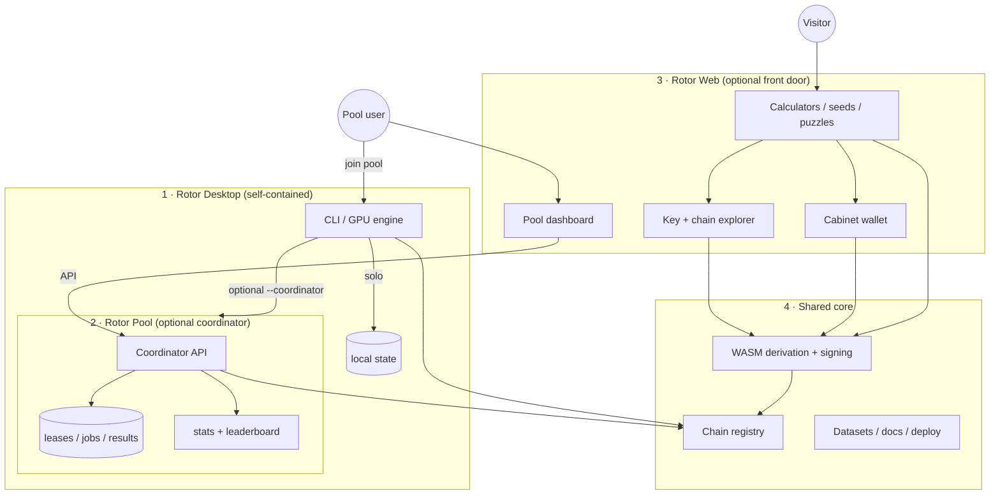

# Rotor architecture: four levels

This document is the maintained map of the products and their optional
connections. Update it whenever a new entry point, deployment target or
backend dependency is added.

## Products

| Level | Product | What it is | Needs our domain? | Needs a backend? |
|---|---|---|---|---|
| 1 | **Rotor Desktop** (`src/`, `crates/`) | Self-contained Rust search tool and GPU/CPU engine. Solo puzzle/key search, all 18 chains. | No | No |
| 2 | **Rotor Pool** (`src/coordinator/`) | Optional coordinator that leases ranges and aggregates results. You can self-host it or join ours. | Only for our hosted pool | Yes, the coordinator itself |
| 3 | **Rotor Web** (`apps/site/`, cabinet) | Public calculators, seed studio, puzzle browser, key/chain pages, cabinet wallet, pool dashboard. | Yes for the hosted experience | Optional; static + serverless or the coordinator |
| 4 | **Shared core, data and ops** | Chain/address/WASM derivation, datasets, docs, deploy, CI. | No | No |

The desktop app is **not** a client of the website. It works offline and never
needs a Rotor account. Joining the pool is an explicit option; only then does it
talk to a coordinator.

## User journeys

**First touch (no account):** landing → calculator/key/seed/puzzle → result and
explorer link. No key, seed or wallet secret is sent to the coordinator.

**Second touch (optional account):** cabinet → download desktop or create a
pool account → see pool status and history. The web UI is a control plane, not
a requirement for the desktop app.

**Third touch (optional infrastructure):** run the desktop binary against our
pool, or deploy your own coordinator; use the cabinet wallet locally; add paid
datasets or advanced tools.

**Fourth touch (operator):** self-host the coordinator, connect workers, manage
jobs and stats. The coordinator can run locally with a JSON state file or on a
server with a reverse proxy.

## Internal documentation artifacts

The site parity audit (every Rotor route and feature compared with
privatekeyfinder.io and secretscan.org) is internal documentation, not a public
route. It lives at `docs/site-map/index.html` and is opened directly or through
a local static server; the coordinator does not embed or serve it.

## Current coupling and target boundary

Today the coordinator binary embeds `apps/site` assets (`include_str!`) and
serves the site. That is convenient but blurs levels 2 and 3.

Target split:

- **Web** can be built statically or via a serverless adapter and deployed to
  Cloudflare Pages/Workers, Netlify, GitHub Pages or a static origin.
- **Coordinator** stays an API/control plane. It may still serve a fallback
  build for single-binary deployments, but the public site must not depend on
  coordinator internals.
- **Desktop** never depends on either; it only uses the coordinator API when
  the user opts into the pool.

Keep the four levels separate in code: web assets, coordinator handlers, desktop
engine and shared core each have their own entry points.

## Deployment variants

| Target | Web | API / admin | Data |
|---|---|---|---|
| Local / single binary | embedded static build | Rust coordinator | JSON state |
| Cloudflare | Pages or Workers Assets | Workers (Hono) | D1 + KV + R2 + Queues/DO |
| Netlify | Astro/static + Functions | Netlify Functions (Hono) | Netlify Blobs or external Postgres (Neon/Supabase) |
| Self-hosted | static build + Caddy/Zoraxy | Rust coordinator or Node serverless runtime | Postgres/SQLite + object storage |

There is no truly “backendless” users/roles/support stack. The realistic split
is **serverless functions + managed storage**:

- **D1 / Postgres** for relational users, roles, sessions, jobs, audit.
- **KV** for low-value cache and feature flags, not for relational data.
- **R2 / Blobs** for datasets and encrypted backups.
- **Queues / Durable Objects** for leases and long-running pool coordination.
- **Workers / Netlify Functions** for auth, CRUD, webhooks and SSR.

## Ready components to reuse

| Need | Recommended | Why |
|---|---|---|
| Static content, routes, i18n | **Astro** content collections + i18n routing | File/remote loaders, typed schemas, static or SSR adapters; deploy guides for Cloudflare/Netlify |
| Portable API | **Hono** | Same code on Workers, Netlify, Node, Deno, Bun; small middleware set |
| DB access / migrations | **Drizzle ORM** | One schema for SQLite/D1/Postgres, typed queries |
| Admin / CRM | **Directus** or **Payload** | Users, roles, permissions, REST/GraphQL, self-hosted or managed; heavier than a static site |
| Content-only admin | **TinaCMS** or **Decap CMS** | Git-based editing without a database |
| UI primitives | **Tailwind + shadcn/ui (Radix)** or **Mantine** | Accessible dialog/popover/tooltip/select primitives; avoid bespoke one-off widgets |
| Auth | **Better Auth / Lucia** with the chosen DB | Sessions, OAuth, roles; keep one adapter |
| Analytics / monitoring | Plausible/Umami + Sentry + uptime checks | Do not build analytics into the CMS |

Astro and Hono both explicitly support Cloudflare and Netlify targets; Directus
and Payload provide the relational admin layer that a pure static site cannot.
Start with the local/serverless variant, keep storage behind repository
interfaces (JSON → D1/Postgres, local files → R2/Blobs), and migration stays an
adapter change rather than a rewrite.

## Update rules

- New page or route: add it to the product/entry table and, if it is a new
  journey, update the diagram.
- New deployment target: add a row to the deployment matrix and name the
  storage/auth adapters.
- New backend dependency: state which level owns it and whether the desktop or
  static web still works without it.
- Keep the diagram in this file; do not maintain a second copy in chat or
  slides.
